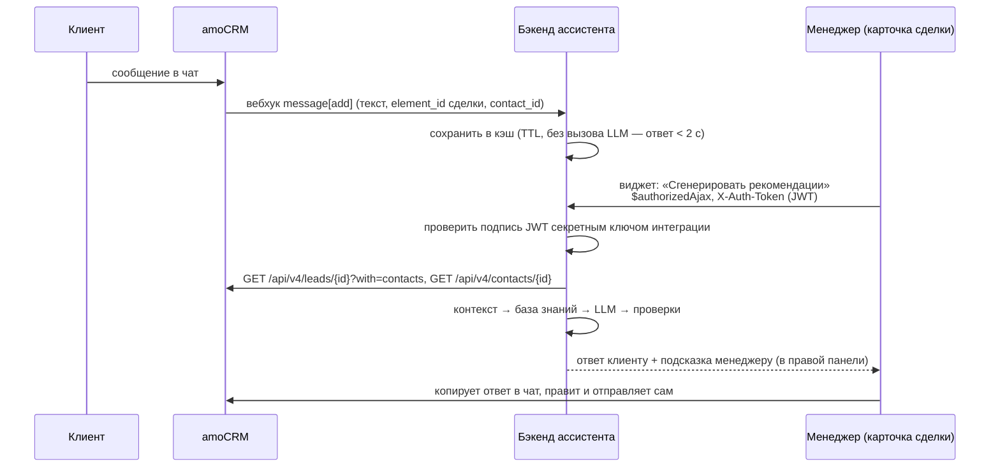

# Интеграция с amoCRM

Документ основан на официальной документации для разработчиков amoCRM (ссылки в конце) и разделяет:

- что подтверждено документацией;
- что реализовано в MVP;
- какие есть ограничения.

## 1. Какие способы интеграции даёт официальный API

| Механизм | Что даёт | Подходит ли для ассистента |
|---|---|---|
| **REST API v4** (`/api/v4/...`), авторизация OAuth 2.0 или долгосрочный токен | сделки, контакты, компании, примечания, задачи | ✅ данные сделки и имя клиента |
| **Вебхуки** | push-уведомления о событиях; для чатов задокументированы `message` (входящее сообщение) и `outgoing_message` (исходящее от пользователя amoCRM или Salesbot) — **с текстом сообщения** | ✅ единственный документированный способ получить тексты чатов из любых каналов |
| **API бесед** (`GET /api/v4/talks`, `GET /api/v4/talks/{id}`, `POST /api/v4/talks/{id}/close`) | метаданные беседы: `talk_id`, `chat_id`, `contact_id`, `entity_id`, статус, канал | ⚠️ **текстов сообщений нет** |
| **API событий** (`GET /api/v4/events`, типы `incoming_chat_message`, `outgoing_chat_message`) | факт сообщения; в `value_after` только `message.id` | ⚠️ **текста нет** |
| **API чатов** (`amojo`, `/v2/origin/custom/{scope_id}/...`, в т. ч. `GET .../chats/{conversation_id}/history`) | история сообщений, отправка сообщений | ❌ работает только для **собственного канала** интеграции: регистрация канала, подпись запросов HMAC-SHA1. Переписку в WhatsApp/Telegram, подключённых другими интеграциями, так не прочитать |
| **Примечания** (`GET/POST /api/v4/leads/{id}/notes`) | внутренние заметки сделки | можно сохранять подсказки (не реализовано, см. «Развитие») |
| **Web SDK — виджеты** | JS-код в интерфейсе amoCRM; области подключения `lcard`, `ccard`, `comcard`, `llist`, `card_sdk`, `settings`, `everywhere` и др.; запросы на свой сервер через `this.$authorizedAjax()` с одноразовым JWT | ✅ показ обоих блоков внутри amoCRM |

**Вывод.** Документированного способа «прочитать переписку чата по ID сделки» через REST API нет. Поэтому история собирается из вебхуков, а вызов ассистента делается из виджета в карточке сделки.

## 2. Схема MVP



### Что делает каждый компонент

**Виджет** (`amocrm_widget/`, область `lcard-1` — правая панель карточки сделки):

- берёт ID сделки из `APP.data.current_card.id` и вызывает `POST {backend_url}/api/v1/amocrm/suggest` через `this.$authorizedAjax()`;
- поле «Сообщение клиента» необязательное. Если оно пустое, сервер берёт последние сообщения клиента из чата (кэш вебхуков). Если вебхуки не настроены, менеджер вставляет текст вручную;
- показывает «Ответ клиенту» (редактируемое поле + «Копировать») и «Подсказку менеджеру» с пометкой «не отправлять клиенту»;
- ничего не отправляет в чат: такого метода в виджете нет.

**Эндпоинт виджета** `POST /api/v1/amocrm/suggest` (`app/api/amocrm.py`):

- проверяет `X-Auth-Token`: подпись HS256 секретным ключом интеграции, `exp`/`nbf`, `client_uuid == AMOCRM_CLIENT_ID`, хост `iss == AMOCRM_BASE_URL`;
- собирает контекст через `AmoCRMAdapter`: несколько подряд идущих сообщений клиента считаются одним обращением; из контакта берётся **только имя** — телефоны, e-mail и прочие поля в LLM не передаются;
- если REST API amoCRM недоступен, генерирует подсказку только по переписке и показывает предупреждение.

**Эндпоинт вебхуков** `POST /api/v1/amocrm/webhook?secret=…`:

- разбирает `application/x-www-form-urlencoded` (`message[add][0][text]`, `...[element_id]`, `...[element_type]`, `...[contact_id]`, `...[talk_id]`, `...[created_at]`);
- сохраняет сообщение в кэш по сделке (когда `element_type` — сделка) и по контакту;
- повторная доставка того же сообщения игнорируется (дедупликация по `id`);
- LLM не вызывается: amoCRM ждёт ответ не дольше 2 секунд, иначе повторяет доставку, а после 100 ошибок за 2 часа отключает вебхук.

## 3. Пошаговая настройка

### Шаг 1. Разверните бэкенд по HTTPS

amoCRM работает по HTTPS, поэтому браузер не позволит виджету обратиться к серверу по HTTP. Для теста подойдёт туннель (cloudflared, ngrok и т. п.) к `localhost:8000`, для работы — сервер с TLS. Вебхуки amoCRM тоже отправляет на публичный адрес.

### Шаг 2. Создайте приватную интеграцию

1. В аккаунте amoCRM (нужны права администратора) откройте **«амоМаркет»** → **«Создать интеграцию»**.
2. Укажите название, описание, доступы и Redirect URI — например, адрес вашего бэкенда. Хост Redirect URI попадает в поле `aud` токена виджета.
3. На вкладке **«Ключи»** скопируйте:
   - **ID интеграции** → `AMOCRM_CLIENT_ID`;
   - **Секретный ключ** → `AMOCRM_CLIENT_SECRET` (им проверяется подпись токена виджета);
   - **долгосрочный токен** (кнопка **«Сгенерировать токен»**, срок от 1 дня до 5 лет, показывается один раз) → `AMOCRM_ACCESS_TOKEN`. Вместо него можно использовать access token OAuth 2.0 — заголовок тот же: `Authorization: Bearer …`.

### Шаг 3. Загрузите виджет

```bash
python scripts/build_widget.py
```

Получится `dist/widget.zip` (`manifest.json`, `script.js`, `style.css`, `i18n/`, `images/` в корне архива). В **«амоМаркет»** откройте интеграцию → **«режим редактирования»** → загрузите архив. Если `manifest.json` некорректен, amoCRM покажет ошибку. Затем установите виджет и в его настройках укажите **адрес сервера ассистента** — например, `https://assistant.example.com`.

### Шаг 4. Подключите вебхуки сообщений

В **«амоМаркет»** → **«WEB HOOKS»** добавьте адрес:

```
https://assistant.example.com/api/v1/amocrm/webhook?secret=<AMOCRM_WEBHOOK_SECRET>
```

и выберите события входящих и исходящих сообщений в чатах.

> Документация amoCRM описывает формат этих вебхуков (`message`, `outgoing_message`), но в списке событий интерфейса они могут называться иначе или быть недоступны на вашем тарифе. Без вебхуков всё работает, но менеджер вставляет сообщение клиента в поле виджета вручную.

### Шаг 5. Включите интеграцию на сервере

```dotenv
AMOCRM_ENABLED=true
AMOCRM_BASE_URL=https://yoursubdomain.amocrm.ru
AMOCRM_ACCESS_TOKEN=...
AMOCRM_CLIENT_ID=...
AMOCRM_CLIENT_SECRET=...
AMOCRM_WEBHOOK_SECRET=длинная-случайная-строка
CORS_ALLOW_ORIGINS=https://yoursubdomain.amocrm.ru
```

`CORS_ALLOW_ORIGINS` обязателен: `$authorizedAjax` делает кросс-доменный запрос из браузера с заголовком `X-Auth-Token`, и сервер должен разрешить домен аккаунта.

### Проверка без amoCRM

Сквозной сценарий проверен на странице-имитации карточки сделки: настоящий `script.js`, `$authorizedAjax` с подписанным JWT, запрос с другого origin (CORS), контекст из вебхуков. Повторить можно тестами:

```bash
pytest tests/test_amocrm.py -v
```

## 4. Ограничения

1. **Нет области виджета внутри окна чата.** Среди документированных областей нет поля ввода сообщения, и нет документированного способа вставить текст в чат из виджета. Поэтому виджет живёт в правой панели карточки сделки (`lcard-1`), а ответ менеджер копирует сам. Это совпадает с требованием «отправляет только менеджер».
2. **История чата только из вебхуков.** Кэш начинает наполняться с момента подключения вебхуков, а более ранние сообщения недоступны. Для них есть ручная вставка в поле виджета. История — до `AMOCRM_HISTORY_LIMIT` последних сообщений за `AMOCRM_MESSAGE_TTL_HOURS` часов.
3. **Кэш в памяти процесса.** Запускайте один процесс uvicorn. Для нескольких реплик замените `MessageStore` на Redis — интерфейс простой: `add`, `for_lead`, `for_contact`.
4. **Вебхуки amoCRM не подписаны.** Защита — секрет в URL и HTTPS. Секрет не попадает в логи: query string вырезается из access-лога.
5. **Привязка чата к сделке.** Если в вебхуке нет сделки (`element_type` — не сделка), сообщение сохраняется по `contact_id`, и адаптер ищет его по контактам сделки.
6. **Вложения** (фото, файлы) не анализируются: в историю попадает пометка «[вложение]».
7. **Kommo** (международная версия amoCRM) использует тот же API на домене `kommo.com`. Укажите соответствующий `AMOCRM_BASE_URL`.

## 5. Развитие

- Кнопка «Сохранить подсказку в примечание» — `POST /api/v4/leads/{id}/notes` с `note_type: "common"` (примечания внутренние и клиенту не видны).
- Вкладка в карточке через область `card_sdk` вместо блока в правой панели.
- Собственный канал через API чатов — если компания сама подключает мессенджеры и хочет полную историю.
- Хранение кэша сообщений в Redis.

## Источники

- [Формат вебхуков](https://www.amocrm.ru/developers/content/crm_platform/webhooks-format) — `message`, `outgoing_message`, тайм-аут 2 с, повторы и отключение.
- [API бесед](https://www.amocrm.ru/developers/content/crm_platform/talks-api) — только метаданные беседы.
- [События и примечания](https://www.amocrm.ru/developers/content/crm_platform/events-and-notes) — `incoming_chat_message`, `outgoing_chat_message`, примечания.
- [API чатов](https://www.amocrm.ru/developers/content/chats/chat-api-reference) — история сообщений для собственного канала, подпись запросов.
- [Механика виджетов](https://www.amocrm.ru/developers/content/web_sdk/mechanics) — callbacks, `render_template`, `crm_post`, `$authorizedAjax`.
- [Структура виджета](https://www.amocrm.ru/developers/content/integrations/structure) — `manifest.json`, `i18n`, логотипы.
- [Загрузка виджета](https://www.amocrm.ru/developers/content/integrations/upload) — `widget.zip`, «режим редактирования».
- [Переменные окружения Web SDK](https://www.amocrm.ru/developers/content/web_sdk/env_variables) — `APP.data.current_card`, `APP.getBaseEntity()`.
- [Одноразовые токены](https://www.amocrm.ru/developers/content/oauth/disposable-tokens) — JWT HS256, состав полей.
- [Пошаговая авторизация](https://www.amocrm.ru/developers/content/oauth/step-by-step) — создание интеграции, ключи, долгосрочные токены.
- [Области подключения виджетов](https://developers.kommo.com/docs/widget-locations) — `lcard`, `card_sdk`, `everywhere` и др. (документация Kommo, общая платформа с amoCRM).
