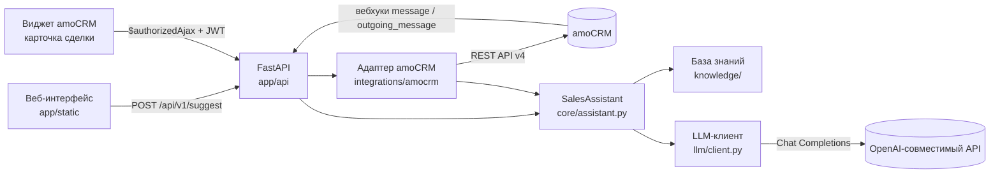

# Архитектура

Документ описывает решения по этапам разработки: что сделано, зачем и как работают основные функции.

## Общая схема

Принцип — **одно направление зависимостей**: API и адаптер amoCRM знают о бизнес-логике, бизнес-логика знает о базе знаний и интерфейсе LLM-клиента, но ничего не знает про HTTP, FastAPI и amoCRM. Поэтому каждый модуль тестируется отдельно, а LLM и amoCRM в тестах подменяются.

---

## Этап 1. Минимальная архитектура

**Решения**

- **Один сервис FastAPI**, без очередей, воркеров и микросервисов. Генерация занимает секунды, менеджер ждёт ответ синхронно — очередь здесь ничего не даёт.
- **Модули по ответственности**: `api` (HTTP), `core` (бизнес-логика), `knowledge` (база знаний), `llm` (клиент модели), `integrations/amocrm` (адаптер CRM).
- **`DialogContext`** (`app/schemas.py`) — единый нормализованный вход бизнес-логики. Его собирает REST API из ручного ввода или адаптер amoCRM из вебхуков и API. Ядру не важно, откуда пришла переписка.
- **`AppError`** (`app/errors.py`) — базовое исключение с HTTP-статусом, машинным кодом и текстом для менеджера. Все ошибки (LLM, база знаний, amoCRM) отдаются клиенту API в одном формате `{"error": {"code", "message"}}`.
- **Конфигурация** (`app/config.py`) — `pydantic-settings`, всё из переменных окружения; секреты типа `SecretStr` не печатаются в repr и логах.
- **Сборка зависимостей** в `create_app()` (`app/main.py`): фабрика принимает настройки, LLM-клиент и клиент amoCRM, поэтому тесты передают фейки без monkeypatch.

---

## Этап 2. База знаний и поиск

### Формат

`data/knowledge_base.json` валидируется Pydantic-моделями из `app/knowledge/models.py`:

- `Product`: название, описание, характеристики, цена (`Price`, допускается `amount: null`), условия, связанные позиции, сценарии допродажи, ключевые слова;
- `FAQEntry`: общие условия (доставка, оплата, гарантия…);
- `KnowledgeBase._check_ids` проверяет уникальность `id` и то, что `related` ссылается на существующие позиции. Ошибка в базе выявляется при загрузке, а не во время разговора с клиентом.

JSON выбран вместо Markdown: строгая схема даёт валидацию, а поля `related` и `price` нужны коду для проверки рекомендаций и сумм.

### Загрузка без перезапуска

`KnowledgeBaseRepository.get()` (`app/knowledge/repository.py`) на каждом обращении сравнивает `mtime` файла. Если файл изменился — перечитывает и валидирует. При ошибке оставляет последнюю корректную версию и сохраняет текст ошибки (виден в `/health`). При старте приложения невалидная база останавливает запуск (fail fast).

### Поиск

Векторная БД для базы из десятков позиций избыточна, поэтому в `app/knowledge/search.py` реализован прозрачный поиск по ключевым словам:

1. `tokenize()` — нижний регистр, `ё → е`, стоп-слова, лёгкий стемминг `stem()`: отрезает типичное русское окончание и обрезает основу до 6 символов («установку», «установка», «установить» → `устано`). Число после слова склеивается с ним («Бриз 18» → `бриз#18`), чтобы «комната 18 м²» не находила модель «Бриз 18».
2. `KnowledgeIndex` строит по каждой позиции набор токенов для каждого поля и считает IDF.
3. `search()` суммирует по токенам запроса: *вес лучшего поля* (название и ключевые слова ×3, категория ×2, описание ×1) × *IDF* × *вес запроса* (текущее сообщение 1.0, последние реплики клиента 0.5 — так «а сколько стоит?» понимается в контексте предыдущего вопроса).
4. К `top_k` найденным позициям добавляются связанные (`related`) — кандидаты для допродажи.

Индекс кэшируется в `SalesAssistant._index()` и перестраивается только при смене версии базы.

---

## Этап 3. LLM и формирование двух ответов

### Клиент (`app/llm/client.py`)

`OpenAICompatibleClient` работает через HTTPX с любым API формата `POST {base_url}/chat/completions`.

- `response_format: json_object` (отключается `LLM_JSON_MODE=false`), `temperature` и `max_tokens` опциональны: часть моделей их не принимает.
- Повторы с экспоненциальной задержкой при таймауте, сетевой ошибке, 429 и 5xx. 401/403 и прочие 4xx — без повторов.
- Каждая ошибка — подкласс `LLMError` со своим HTTP-статусом и понятным сообщением.
- В логи попадают только статус-коды и типы ошибок.

Ядро зависит не от класса, а от протокола `LLMClient` (`model` + `complete(messages)`), поэтому провайдера легко заменить.

### Промпт (`app/core/prompts.py`)

- **System**: роль (ассистент *менеджера*, а не клиента), правила работы с фактами, безопасности, правила для каждого из двух блоков и точная JSON-схема.
- **User**: блоки `<knowledge_base>` (полные факты найденных позиций), `<catalog>` (только названия всех позиций — для уточняющих вопросов, без цен), `<client_info>`, `<dialog_history>`, `<customer_message>`. Данные клиента изолированы в блоках и явно объявлены недоверенными.

### Pipeline (`app/core/assistant.py`, `SalesAssistant.suggest`)

1. **Нормализация**: `sanitize_untrusted()` убирает управляющие символы и служебные теги, обрезает длину; история ограничивается по числу сообщений и символов (сохраняются последние); `redact_pii()` маскирует телефоны, e-mail и номера карт.
2. **Поиск** фактов по сообщению и контексту.
3. **Сборка промпта** `build_messages()`.
4. **Вызов LLM**.
5. **Валидация** `parse_suggestion()`: снимает markdown-обёртку, извлекает JSON и проверяет схемой `Suggestion`. При ошибке — одна повторная попытка с сообщением, что именно не так (`REPAIR_PROMPT`); при повторной ошибке — `LLMOutputError` (HTTP 502).
6. **Пост-проверки** (`app/core/guards.py`):
   - `enforce_upsell_rules()` — рекомендация должна существовать в базе (по `id` или однозначно по названию), название подставляется из базы; если допродажа неуместна, поля рекомендации очищаются, а причина обязательна;
   - `strip_internal_leaks()` — из ответа клиенту удаляются предложения со служебной лексикой («допродажа», «подсказка менеджеру», названия полей JSON) и копии `upsell_reason` / `suggested_sales_phrase`;
   - `find_unverified_amounts()` — суммы и проценты, которых нет ни в базе знаний, ни в переписке, попадают в предупреждения (сумма двух известных цен — например, «товар + монтаж» — считается проверенной).

Результат — `SuggestResponse`: `suggestion` (два блока) + `meta` (источники, предупреждения, признак prompt injection, модель, время).

**Почему пост-проверки не блокируют, а предупреждают**: финальное решение принимает менеджер. Жёсткая блокировка из-за эвристики остановила бы работу, а предупреждение показывает, что именно перепроверить.

---

## Этап 4. FastAPI и демонстрационный интерфейс

- `app/api/routes.py` — `POST /api/v1/suggest` (история списком `history` или текстом `history_text`, разбор в `core/dialog.py`), `GET /health`, `GET /api/v1/knowledge-base`.
- Документация API генерируется автоматически: `/docs` (Swagger UI) и `/openapi.json`; в схемах есть описания полей и пример запроса.
- Обработчики ошибок в `create_app()`:
  - `AppError` → единый JSON;
  - ошибка валидации → список полей **без значений** (в значениях могут быть ПДн);
  - непредвиденное исключение → 500 и запись в лог только типа и стека вызовов, без текста исключения.
- `app/logging_setup.py` — фильтр-страховка, маскирующий токены, JWT, e-mail и телефоны в любых логах; из access-лога uvicorn убираются IP и query string (в URL вебхука есть секрет).
- **UI** (`app/static/`): чистые HTML/CSS/JS без сборки и внешних зависимостей. Слева — сообщение, история, имя; справа — «Ответ клиенту» (редактируемое поле + «Копировать») и «Подсказка менеджеру» с явной пометкой «Только для вас — не отправлять клиенту». Ответ модели выводится только через `textContent`/`value`, без HTML. Адаптивная вёрстка и тёмная тема.

---

## Этап 5. Тесты и Docker

- `tests/` — 94 теста pytest. `FakeLLM` (`tests/conftest.py`) возвращает заданные ответы и сохраняет промпты, чтобы проверять, *что* ушло в модель; HTTP LLM-провайдера и amoCRM мокается через `httpx.MockTransport`.
- Обязательные сценарии из ТЗ: нехватка информации (`test_insufficient_information_leads_to_clarifying_question`) и неуместная допродажа (`test_upsell_not_applicable_for_complaint`, `test_upsell_of_unknown_product_is_blocked`).
- `Dockerfile`: `python:3.12-slim`, установка зависимостей отдельным слоем, запуск от непривилегированного пользователя, `HEALTHCHECK` по `/health`.
- `docker-compose.yml`: `.env` для секретов, `./data` монтируется только для чтения, поэтому базу знаний можно править без пересборки.

---

## Этап 6. Интеграция с amoCRM

Подробно — в [AMOCRM_INTEGRATION.md](AMOCRM_INTEGRATION.md). Модули:

- `integrations/amocrm/webhooks.py` — разбор form-urlencoded вебхуков `message[add]` / `outgoing_message[add]` в `StoredMessage`;
- `integrations/amocrm/message_store.py` — потокобезопасный кэш последних сообщений по сделке и контакту: дедупликация повторной доставки, лимит на сделку, TTL;
- `integrations/amocrm/client.py` — `GET /api/v4/leads/{id}?with=contacts` и `GET /api/v4/contacts/{id}`;
- `integrations/amocrm/auth.py` — `verify_widget_token()`: проверка подписи HS256 секретным ключом интеграции, срока действия, `client_uuid` и адреса аккаунта `iss`;
- `integrations/amocrm/adapter.py` — `AmoCRMAdapter.build_context()`: текущее сообщение (из поля виджета или последние подряд идущие сообщения клиента), история, имя клиента. При недоступности API amoCRM работает только по переписке и добавляет предупреждение;
- `app/api/amocrm.py` — эндпоинты для виджета и вебхуков;
- `amocrm_widget/` — виджет для правой панели карточки сделки.

## Что сознательно не сделано

- Нет векторной БД, агентов, очередей и микросервисов — для MVP с небольшой базой знаний они не нужны.
- Нет автоматической отправки сообщений клиенту — это требование ТЗ, а не ограничение.
- Нет хранения переписки в БД: только короткоживущий кэш вебхуков в памяти, чтобы не накапливать персональные данные.
